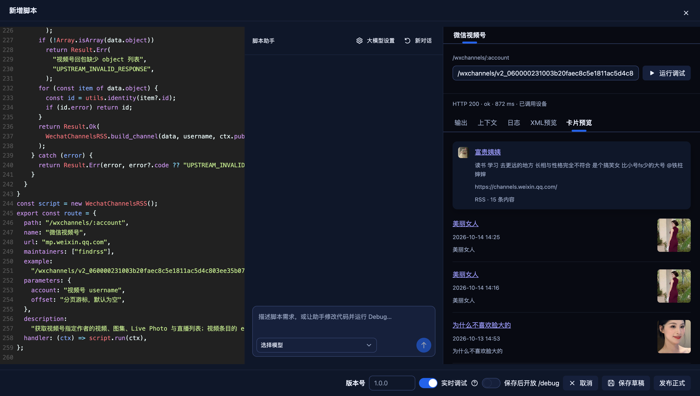
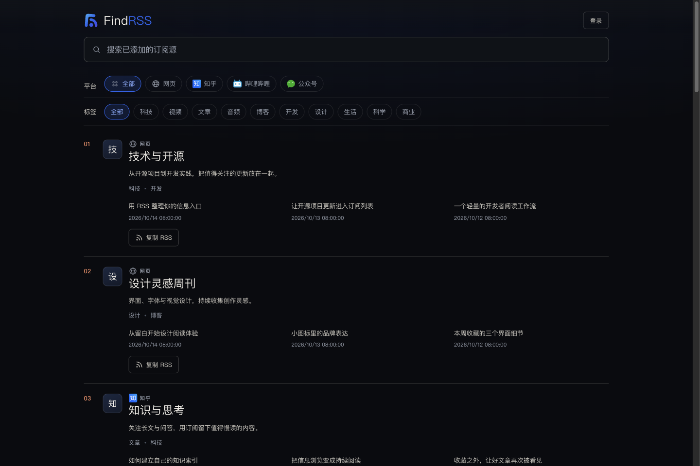

  

<h1 align="center">FindRSS</h1>

自己部署 · 自定义采集 · 生成订阅

  <a href="#快速开始">怎么使用</a> ·
  <a href="#界面预览">界面预览</a> ·
  <a href="#采集示例">采集示例</a> ·
  <a href="#一键部署到-cloudflare-workers">一键部署</a>

FindRSS 是一个可以自己部署的爬虫工具。你可以为任意网站自定义采集规则，将文章、视频、动态等内容转换成 RSS 订阅源。

让原本没有订阅功能的网站，也能在阅读器里持续跟踪更新。

## 能做什么

- **采集网站内容**：提取你想关注的文章、视频、作者动态或小说章节。
- **自定义采集规则**：使用现成示例，自己编写，或让内置助手协助完成。
- **生成订阅地址**：发布后即可添加到阅读器，持续获取更新。
- **自己掌控**：采集什么、何时修改、是否公开，都由你决定。

## 界面预览

**采集工作区**：编写规则、使用助手、预览采集结果，确认后发布。

**订阅广场**：展示生成的订阅源，方便预览、查找和分享。

## 快速开始

从网站内容到订阅更新：

1. **部署工具**：通过下方[一键部署](#一键部署到-cloudflare-workers)创建自己的站点。
2. **配置采集**：进入后台「脚本」，新建采集规则。可以复制下方的[常用脚本](#采集示例)，也可以配置内置助手，告诉它网站地址和想采集的内容。
3. **预览并发布**：点击「运行调试」查看结果，确认后发布正式版本并启用。
4. **添加订阅源**：在后台「订阅源」中添加与已发布规则对应的订阅地址。
5. **开始订阅**：复制地址，添加到阅读器，以后就能集中查看新内容。

RSS 是供阅读器获取更新的订阅格式。阅读器是用来集中查看这些更新的应用。

详细操作见[创建自己的订阅源](docs/setup.md#创建自己的订阅源)。

## 采集示例

项目提供以下常用脚本。**点击脚本名称打开文件，再用文件页的复制按钮一键复制全部内容**，粘贴到后台「脚本」中调试、发布。

| 脚本（点击打开） | 采集内容 |
| --- | --- |
|  [哔哩哔哩](examples/scripts/rss/bilibili.js) | UP 主视频与动态 |
|  [YouTube](examples/scripts/rss/youtube.js) | 频道视频 |
|  [知乎](examples/scripts/rss/zhihu.js) | 动态、回答、文章、视频等 |
|  [微博](examples/scripts/rss/weibo.js) | 用户微博 |
|  [X](examples/scripts/rss/x_user.js) | 用户推文 |
|  [抖音](examples/scripts/rss/douyin_user.js) | 作者视频与图集 |
|  [快手](examples/scripts/rss/kuaishou_user.js) | 作者作品 |
|  [小红书](examples/scripts/rss/xiaohongshu_user.js) | 用户笔记 |
|  [Telegram](examples/scripts/rss/telegram_channel.js) | 公开频道消息 |
|  [番茄小说](examples/scripts/rss/fanqienovel_chapters.js) | 章节目录与正文 |
|  [起点中文网](examples/scripts/rss/qidian_chapters.js) | 章节目录与正文 |
|  [69 书吧](examples/scripts/rss/69shuba_chapters.js) | 章节目录 |
|  [天天看书](examples/scripts/rss/ttk_chapters.js) | 章节目录 |
|  [Apple App Store](examples/scripts/rss/apple.js) | 应用版本更新 |

也可以编写其他网站的采集规则。部分脚本需要登录账号或连接设备，具体要求见[示例说明](examples/scripts/README.md)。

> 可以配合 [dm-extension 浏览器插件](https://github.com/ltaoo/dm-extension)，将 Cookie 提交到自己部署的 FindRSS，供采集脚本使用。

## 一键部署到 Cloudflare Workers

点击下方按钮，将采集工具部署到自己的账号：

  

1. 准备 GitHub 和 Cloudflare 账号，点击按钮并按提示授权。
2. 按提示填写站点名称，将 `ADMIN_PASSWORD` 设置为你的后台登录密码。
3. 等待完成，打开生成的站点地址；在地址后加 `/admin/` 进入后台。

首次部署后没有预置采集规则，需要先在后台配置并发布。遇到配置问题，查看[安装与配置指南](docs/setup.md)。

## 更多文档

- [安装与配置](docs/setup.md)：创建站点、本地运行和常用设置。
- [采集示例](examples/scripts/README.md)：各来源的使用要求与示例。
- [管理后台](admin/README.md)：来源管理、助手和设备设置。
- [技术指南](docs/technical-guide.md)：开发与扩展说明。

反馈问题时，请附上操作步骤、错误提示或截图，并隐藏密码等个人信息。
